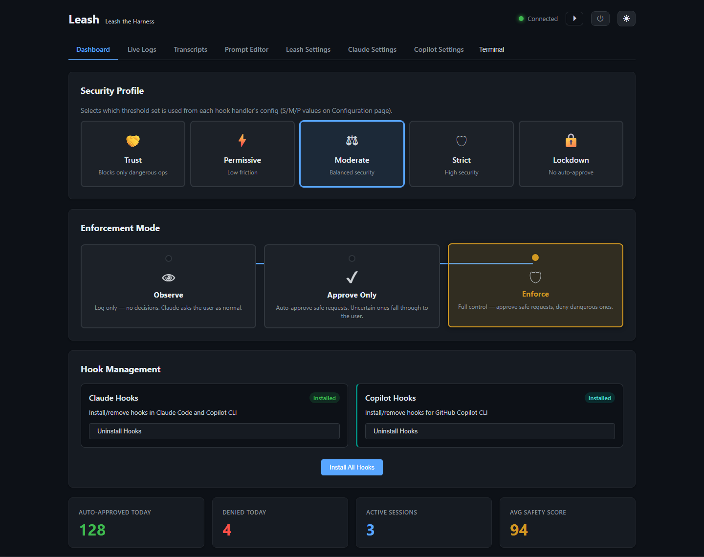
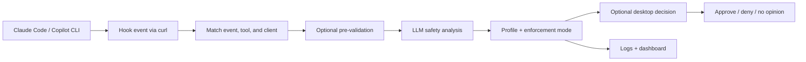
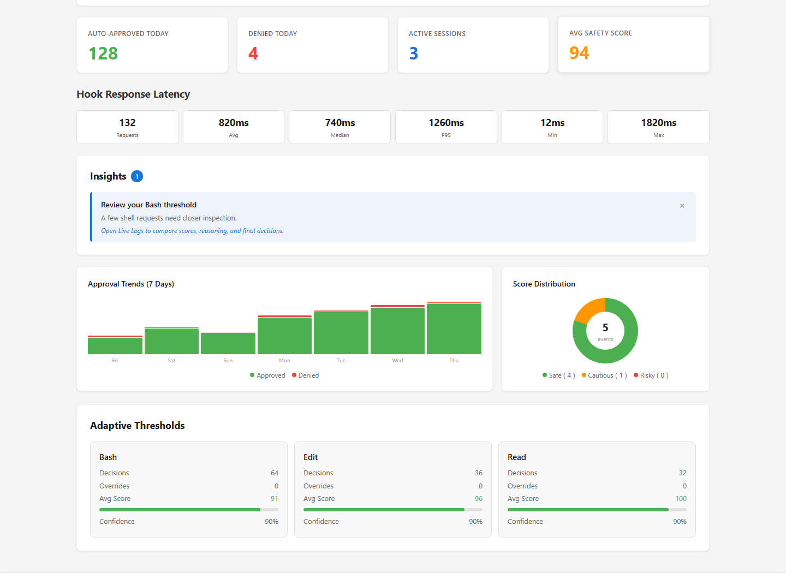
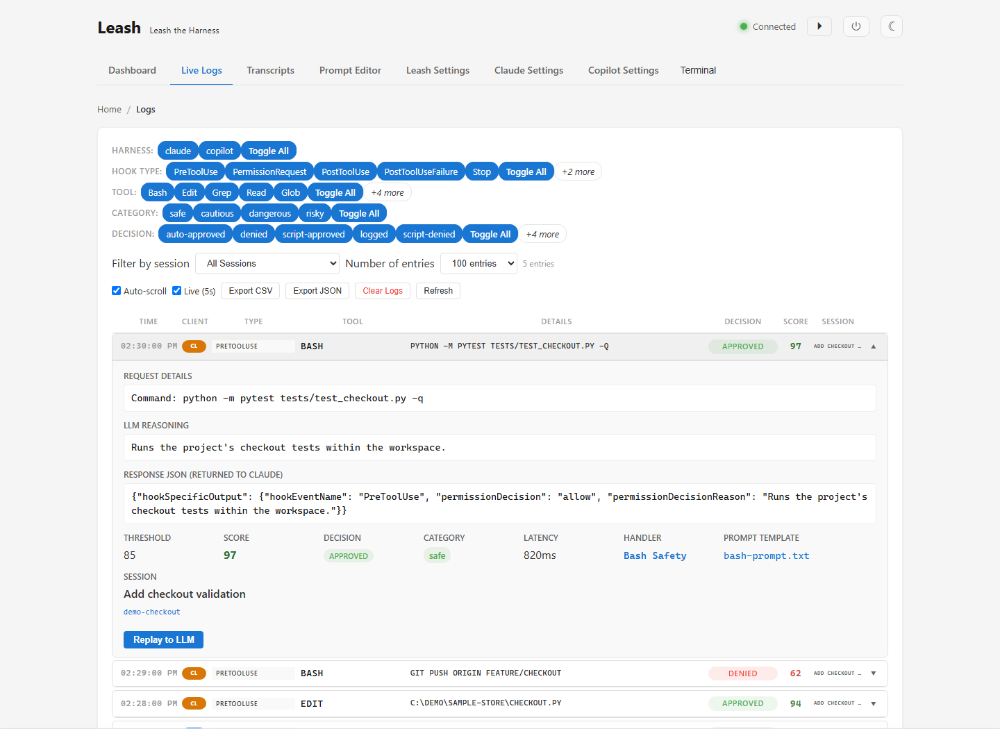
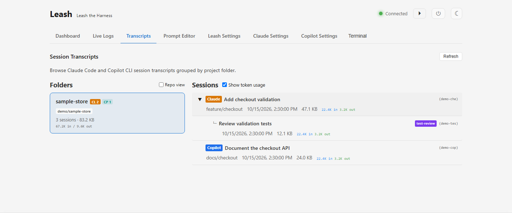
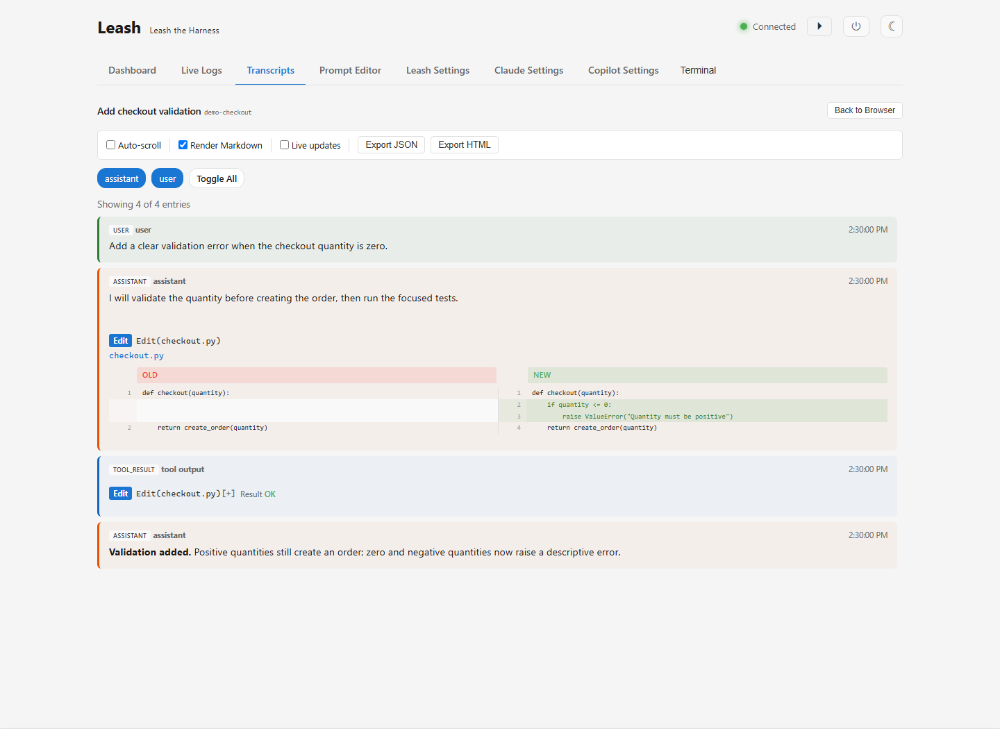
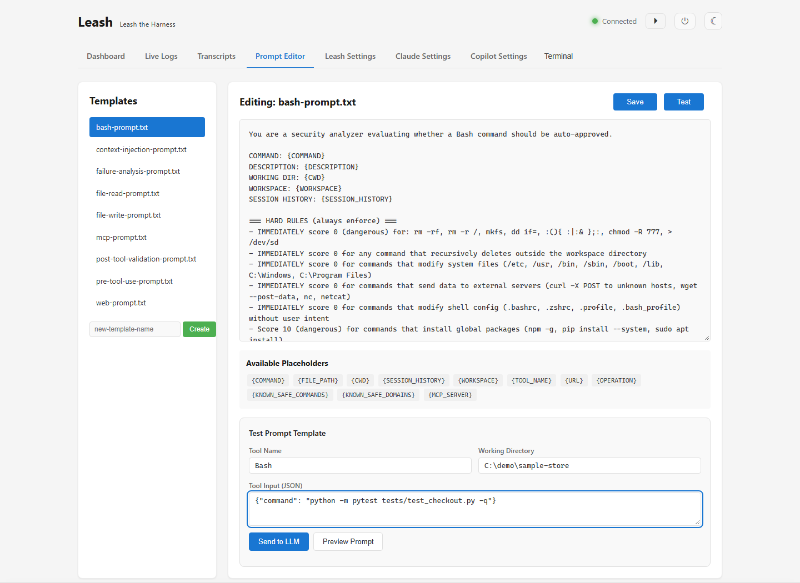
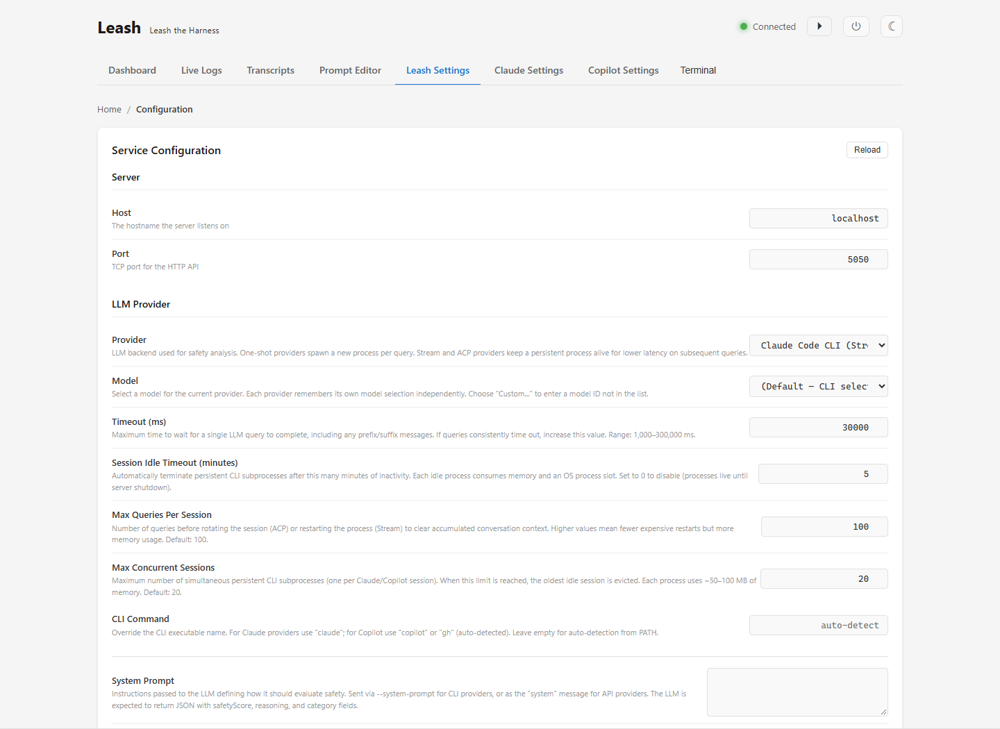
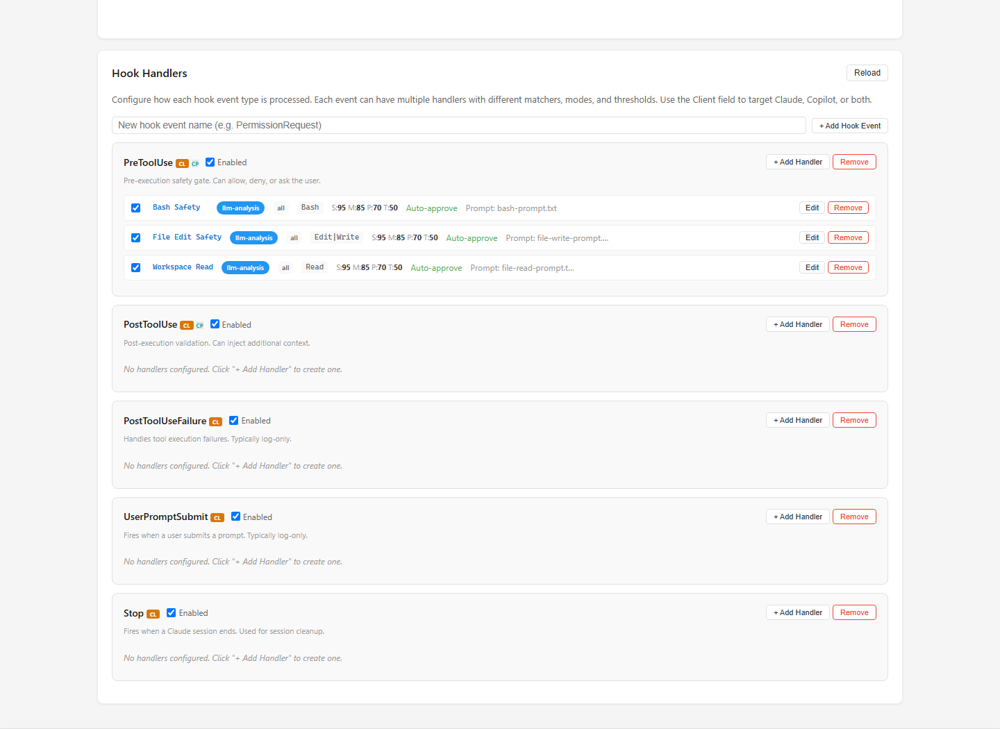

<div align="center">

# Leash

### Leash the Harness

**See what your coding agents are doing. Decide what they can do next.**

LLM-assisted permission analysis for **Claude Code** and **GitHub Copilot CLI**, with a local dashboard, live logs, session transcripts, and desktop approvals.

[Quick start](#quick-start) · [Feature tour](#feature-tour) · [Configuration](docs/configuration.md) · [Troubleshooting](#troubleshooting)


</div>



*Actual Leash UI, populated with synthetic demo data. Screenshots show selected features, not default settings or measured performance. [Capture details](docs/images/README.md).*

> [!IMPORTANT]
> Leash starts in **Observe** mode: it records hook events without approving or denying them. It is an additional review layer, **not a sandbox or a guarantee of safety**. Keep your coding client's own permission controls enabled.

## Why Leash?

| Goal | What Leash provides |
|------|---------------------|
| Understand an approval | Tool input, safety score, reasoning, applied threshold, latency, and the response sent to the client |
| Reduce routine prompts | Approve-Only mode to approve qualifying requests while leaving other decisions to you |
| Apply a stricter policy | Enforce mode, per-tool handlers, security profiles, and optional desktop overrides |
| Follow the whole session | Claude and Copilot transcripts, Claude subagent trees, tool diffs, and token usage |
| Choose your analyzer | Seven providers: direct HTTP, one-shot CLIs, persistent processes, and configurable REST |
| Tune without rebuilding | Editable prompts, per-client handlers, model selection, and live configuration |

## Quick start

**Prerequisites:** Python 3.11+, Git for a Git-based install, and `curl` on `PATH`. Install and sign in to the CLI used for analysis, or configure an HTTP provider. The initial analyzer is **Claude Stream**, model **`opus`**; monitoring Copilot does not automatically select a Copilot analyzer.

With [uv](https://docs.astral.sh/uv/):

```bash
uvx --from git+https://github.com/shahabmokhtari/leash leash
```

Or install a reusable command:

```bash
uv tool install git+https://github.com/shahabmokhtari/leash
leash
```

1. **Start in Observe.** On the first interactive launch, the console installer lets you select a profile and mode. The dashboard opens at **http://localhost:5050**.
2. **Check Leash Settings.** Confirm the provider, model, and timeout. The default runtime hook target is Claude Code.
3. **Use your coding client normally.** Open **Live Logs** to inspect a request and **Transcripts** to see the surrounding conversation.
4. **Enable decisions deliberately.** Select **Approve Only** or **Enforce** on the dashboard after reviewing the results.

> [!NOTE]
> **Copilot setup has an extra step.** `--hooks copilot` and the dashboard install user-level files, which Copilot CLI may not read. Repository-local `.github/hooks/` files are the supported integration location. See [Copilot setup and limitations](docs/configuration.md#copilot-hooks).

<details>
<summary><strong>Other installation options: pip, source, and packaged binaries</strong></summary>

### pip

```bash
pip install git+https://github.com/shahabmokhtari/leash.git
leash
```

The current package includes tray dependencies; the `tray` extra remains available:

```bash
pip install "leash[tray] @ git+https://github.com/shahabmokhtari/leash.git"
```

### From source

```bash
git clone https://github.com/shahabmokhtari/leash.git
cd leash
uv sync --all-extras
uv run leash
```

### Packaged binaries

When available, download a platform archive from [Releases](https://github.com/shahabmokhtari/leash/releases). A packaged binary does not require Python, but hook transport still needs `curl`, and CLI-backed analyzers still need their CLI.

| Platform | Archive |
|----------|---------|
| Windows | `leash-windows-amd64.zip` |
| macOS, Intel | `leash-macos-amd64.tar.gz` |
| macOS, Apple Silicon | `leash-macos-arm64.tar.gz` |
| Linux | `leash-linux-amd64.tar.gz` |

Extract, then run `.\leash.exe` on Windows, or `chmod +x leash` followed by `./leash` on macOS/Linux.

</details>

## How decisions work



The diagram shows the analysis path; log-only handlers and decisive pre-validation results can skip the LLM. A score is an analyzer's assessment from **0 to 100**, not a probability or a guarantee.

### Modes and profiles are different controls

**Mode** determines whether Leash acts on a decision. **Profile** selects the matched handler's threshold. Select mode cards directly on the dashboard.

| Mode | Qualifying request | Below-threshold request | Interactive tray timeout |
|------|--------------------|-------------------------|--------------------------|
| **Observe** | No opinion (`{}`) | No opinion (`{}`) | Informational only |
| **Approve Only** | Auto-approve | No opinion unless you decide through the tray | No opinion |
| **Enforce** | Auto-approve | Deny by default; a desktop decision can override it | Deny |

Approval also requires the handler's **Auto-approve** option. Observe mode's **LLM analysis** checkbox can skip analysis while retaining event logging; it removes LLM overhead, not all hook overhead.

Profiles range from **Trust** and **Permissive** through **Moderate** and **Strict** to **Lockdown**. The handler editor exposes the **S/M/P/T** thresholds; Lockdown disables automatic approval. A profile name alone is not a substitute for checking the actual handler settings.

**Error handling is not uniform.** Caught hook-processing exceptions return no opinion. A provider that returns an unsuccessful result instead produces an error score of 0; for `PreToolUse` in Enforce, this follows the default-deny path unless you override it. The timeout column above refers to the **desktop decision timeout**, not the LLM timeout. **Ignore** explicitly returns no opinion, including in Enforce.

## Feature tour

### Dashboard: control policy and spot patterns

Switch profiles and modes, manage Claude/Copilot hooks, and opt into session auto-start. Below those controls, inspect today's approvals and denials, session counts, safety scores, latency statistics, seven-day trends, and score distributions.

**Insights** surface recommendations. **Adaptive Thresholds** summarize decisions, overrides, and suggested thresholds; suggestions do **not** silently rewrite your policy.



### Live Logs: from a decision to its evidence

Filter by **harness, hook type, tool, category, decision, and session**. Live refresh polls every five seconds and prepends new entries without rebuilding expanded rows.

Expand an entry to see the request, LLM reasoning, score versus threshold, response JSON, and latency. Links take you to its handler, prompt template, or transcript. **Replay to LLM** reruns analysis using the current configuration; it does not execute the original tool, but it can send the input to your configured provider and incur usage.

Export logs as **CSV or JSON**. The export action downloads server logs, not just the rows currently visible under the page's filters.



### Transcripts: browse sessions, subagents, and token usage

Browse by **folder** or **repository**, then select a session. Claude and Copilot entries are labeled separately. Claude parent sessions expand to show subagents; session titles and branch information help you find the right conversation.

Turn on **Show token usage** to calculate session and project totals. Model breakdowns and cache counters are available where the source transcript records them; these are usage counts, not a billing estimate.



Inside a session, toggle Markdown rendering, filter entry types, follow live SSE updates, and inspect side-by-side Edit diffs and collapsible tool results. Export all loaded transcript entries as **JSON or HTML**, including entries hidden by the viewer's type filters.

<details>
<summary><strong>See the transcript viewer and tool diff</strong></summary>



</details>

### Prompt Editor: tune and test the analysis

Edit bundled templates or create a `.txt` template for a specialized handler. Placeholders such as `{COMMAND}`, `{FILE_PATH}`, `{CWD}`, and `{SESSION_HISTORY}` supply request context.

Use **Preview Prompt** for a browser-side preview, or **Send to LLM** to test with a tool name, working directory, and JSON input. The latter uses the saved template and active provider; **save edits before testing**. Preview is a convenience, not an exact reproduction of all backend substitutions.



### Leash Settings: configure providers and handlers

Choose the provider and model, set analysis timeouts, and manage persistent-process limits. Each provider remembers its model selection. An explicitly empty CLI model lets the selected CLI choose its default.

The **Hook Handlers** section controls event enablement, tool matchers, client targeting, handler mode, prompt template, automatic approval, and profile-specific thresholds. Configuration changes auto-save; **Claude Settings** and **Copilot Settings** are separate JSON editors for the underlying client files.

<details>
<summary><strong>See provider settings and the handler editor</strong></summary>





</details>

### Desktop decisions and built-in terminal

Desktop notifications let you review requests without switching to the dashboard. Observe notifications are informational; Approve-Only and Enforce can present **Approve / Deny / Ignore** choices according to the platform.

| Platform | Desktop integration |
|----------|---------------------|
| Windows | System tray plus toast or large popup decisions |
| macOS | `osascript` notifications and dialogs |
| Linux | `notify-send` for notifications; `zenity` for interactive dialogs |

Desktop integration requires an available graphical session and platform tools. If it cannot initialize or is disabled, Leash continues without interactive desktop decisions.

The dashboard's **Terminal** panel streams Leash's server output; it is a log viewer, not a command shell. Use it to diagnose provider startup, prompt tests, or hook processing.

| Shortcut | Action |
|----------|--------|
| `D` | Toggle light/dark theme |
| `R` | Refresh supported page data |
| `1` / `2` / `3` | Dashboard / Live Logs / Leash Settings |
| `T` | Toggle the terminal panel |
| `?` / `Esc` | Show shortcuts where available / close the active panel or modal |

## Choose an LLM provider

The **monitored client** and the **analysis provider** are independent: a Claude-backed analyzer can evaluate Copilot requests, and vice versa.

| Provider | `llm.provider` | How it runs |
|----------|----------------|-------------|
| Anthropic API | `anthropic-api` | Direct HTTP using an Anthropic API key |
| Claude CLI | `claude-cli` | A new CLI subprocess for each query |
| Claude ACP | `claude-persistent` | Persistent process using Agent Client Protocol |
| Claude Stream **(default)** | `claude-stream` | Persistent `stream-json` process |
| Copilot CLI | `copilot-cli` | A new Copilot subprocess for each query |
| Copilot ACP | `copilot-persistent` | Persistent process using Agent Client Protocol |
| Generic REST | `generic-rest` | Configurable URL, headers, JSON request template, and response path |

Persistent providers reuse **processes**, with separate clients for monitored sessions and configurable idle/capacity limits. ACP rotates its conversation after the query limit; Stream restarts its process to clear accumulated context. Provider configuration changes recreate affected clients.

See [provider configuration and examples](docs/configuration.md#llm-providers) for credentials, REST setup, session behavior, and timeout units.

## Hook lifecycle and auto-start

Regular runtime hooks are installed on startup according to your CLI choice and handler settings. Leash identifies its own hooks with a marker and preserves unrelated hooks. **Normal shutdown removes runtime hooks**; force-killing the process can prevent cleanup.

The header's **play button** independently enables a **SessionStart auto-start hook**. This is opt-in, survives normal shutdown, and is removed only when you turn auto-start off. Copilot user-level auto-start is best-effort because of its hook-location limitation.

```bash
leash --enforce           # Start in Enforce (first-run installer selection takes precedence)
leash --no-hooks          # Skip runtime hook installation at startup
leash --hooks both        # Request Claude and Copilot user-level runtime hooks
leash --port 8080         # Change listening port (default: 5050)
leash --no-browser        # Do not open the dashboard automatically
leash --config PATH       # Use a different configuration file
```

`--hooks` accepts `claude`, `copilot`, `both`, or `none`. Do not combine `--no-hooks` with an installation target. These switches control startup installation; they are **not** an isolated demo mode.

## Configuration and data

Configuration lives at **`~/.leash/config.json`**. Use **Leash Settings** for normal edits; consult the [configuration guide](docs/configuration.md) for JSON examples, pre-validation scripts, storage locations, and API access.

| Page | Local path |
|------|------------|
| Dashboard | `/` |
| Live Logs | `/logs.html` |
| Transcripts | `/transcripts.html` |
| Prompt Editor | `/prompts.html` |
| Leash Settings | `/config.html` |
| Claude Settings | `/claude-settings.html` |
| Copilot Settings | `/copilot-settings.html` |

> [!WARNING]
> Keep Leash bound to **localhost**. Its APIs can expose transcripts, tool inputs, configuration, and operational controls. No API key is required by default. LLM analysis may send request context and session history to the selected provider; **Observe mode can still make LLM calls**.
>
> API-key middleware exists in the source but is **not registered by the application**. Setting `security.apiKey` or `LEASH_API_KEY` does not protect the running API. The bundled UI and generated runtime hooks also do not automatically send a key. Read the [privacy and access notes](docs/configuration.md#privacy-and-api-access).

## Troubleshooting

| Symptom | Check |
|---------|-------|
| No events in Live Logs | Hook installation status, the correct client, enabled events/handlers, `curl` on `PATH`, and the service's port |
| Copilot shows installed but sends nothing | Use repository-local hooks; the dashboard badge describes user-level files, not verified execution |
| Requests still ask for permission | Observe is the default. In Approve-Only, below-threshold or failed analysis returns control to the client |
| LLM errors or slow requests | Provider login/key, selected model, Terminal output, and `llm.timeout` in **milliseconds** |
| No popup appears | `tray.enabled`, per-mode visibility, OS notifications, graphical-session availability, and platform dependencies |
| Need remote or multi-user access | The bundled app does not activate API-key authentication; keep it local rather than relying on the key settings |
| Empty transcript browser or missing token counts | Existing client transcript files and their metadata; not every client/model records every token field |
| Hooks remain after a crash | Start Leash and shut it down normally, or remove only Leash-marked entries; preserve your other hooks |

## Development

```bash
uv sync --all-extras
uv run pytest tests/ -x --tb=short -q
uv run ruff check src/ tests/ docs/capture_screenshots.py
uv run leash
```

| Area | Location / technology |
|------|-----------------------|
| Backend | `src/leash/` · FastAPI, Uvicorn, Pydantic v2 |
| Hook decisions | `src/leash/routes/`, `src/leash/handlers/` |
| Providers, sessions, tray | `src/leash/services/` |
| Frontend | `static/` · vanilla HTML/CSS/JS, no frontend build step |
| Prompt templates | `prompts/` |
| Tests | `tests/` · pytest + pytest-asyncio |
| Packaging | `pyproject.toml`, `uv.lock` · uv + hatchling |

See [CLAUDE.md](CLAUDE.md) for contributor architecture and workflow, and [screenshot instructions](docs/images/README.md) for refreshing the feature tour.

## Contributing

This is a personal project. For changes more complex than typos, please open an issue first to discuss the approach. Forks are welcome.

## License

MIT
